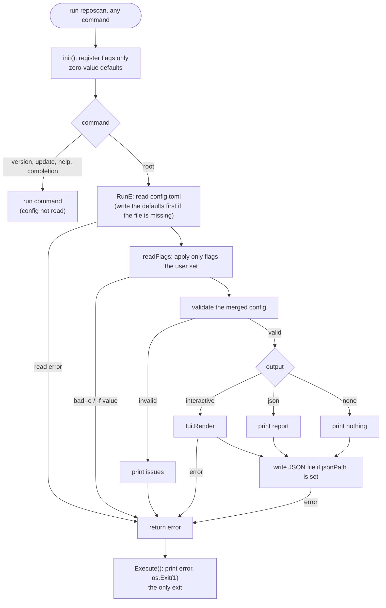

# Config Loading

How `reposcan` turns `config.toml` and CLI flags into the configuration a scan uses.

## Flow

- Only the root command reads `~/.config/reposcan/config.toml`.
  - `--help`, `version`, `update` and `completion` work even when the config is broken.
- Validation runs once, after flags are applied.
  - A flag can replace a bad config value, for example `reposcan -r ~/Code` when `roots` in the config points to a missing directory.
- Errors are returned to `Execute()`, which prints `Error: ...` and exits with status 1.

## Flag defaults and `--help`

Every flag that maps to a config key is registered with its zero value (`""`, `0`, `false`, empty list).

- `readFlags` applies a flag only when `cmd.Flags().Changed(name)` is true, so the registered value is never read.
- pflag omits `(default ...)` from `--help` for zero values, so help never shows a default that the user's config contradicts.
- See [cli-flags-and-configs.md](cli-flags-and-configs.md) for each flag's config key.

Flags that are not backed by config, such as `update --alias`, keep their real default.
